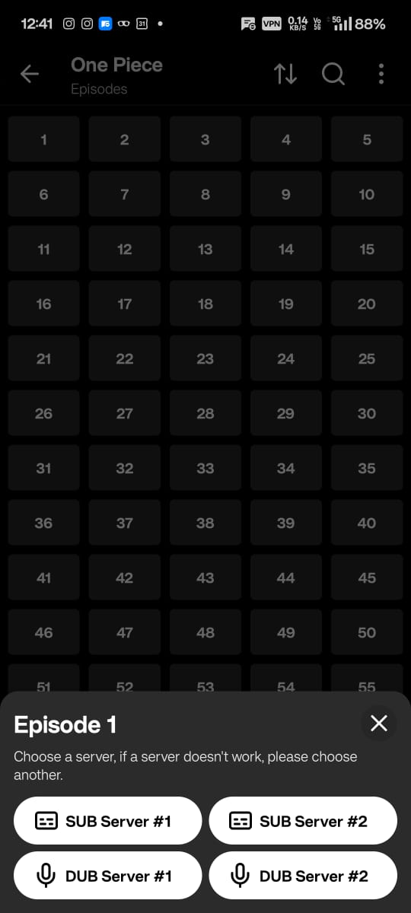

# Parama Padida (பரமா படிடா) 🎓

An offline-first, distraction-free Android learning app for YouTube playlists with Kyoto Player integration, automatic learning folder creation, and watch-progress tracking.



---

## ✨ Features

- **Automated Learning Folders**: Paste any YouTube playlist URL — Parama Padida extracts all lessons and organizes them in a standardized folder (`Movies/ParamaPadida/<Course Title>/`).
- **One Piece / Episode Grid UI**: Visual 5-column numbered grid matching the episode selection aesthetic, showing instant completion checkmarks, offline status, and progress.
- **Dual Playback Engine**:
  - **In-App Media3 Player**: Embedded ExoPlayer with gesture controls, variable speed presets (`0.5x` – `2.5x`), and timestamp-based study notes.
  - **Kyoto Player Integration**: 1-tap launch into Kyoto Player (`com.kyotoplayer`) via Android intents with direct stream links or downloaded local video files.
- **Smart Watch Tracking**:
  - Automatically marks lessons completed at **90% watch time**.
  - Remembers exact resume timestamps.
  - 1-tap manual checkbox toggle in the episode bottom sheet.
  - Overall playlist progress bar (`X / Y lessons watched • Z%`).
- **On-Device yt-dlp & FFmpeg**:
  - Powered by `youtubedl-android` (no external servers needed).
  - Background downloads via Android WorkManager with progress notifications.
- **Timestamped Study Notes**: Add notes while watching lessons; tap any note to instantly jump to that point in the lecture.
- **System Share Receiver**: Share any YouTube playlist link from the YouTube app directly into Parama Padida.

---

## 🏗 Tech Stack

- **Platform**: Android Native (API 26+)
- **Language**: Kotlin 2.0.21
- **UI Toolkit**: Jetpack Compose + Material 3 (Sleek Dark Theme)
- **Local Storage**: AndroidX Room (SQLite)
- **Extractor / Downloader**: `youtubedl-android` (`yt-dlp` + `ffmpeg`)
- **Video Engine**: AndroidX Media3 (ExoPlayer)
- **Background Tasks**: AndroidX WorkManager
- **Image Loading**: Coil Compose

---

## 🚀 Building & Running

Ensure you have Android SDK and JDK 17 installed.

```bash
# Build Debug APK
./gradlew assembleDebug

# Install on connected device
./gradlew installDebug
```

The compiled APK will be located at:
`app/build/outputs/apk/debug/app-debug.apk`
