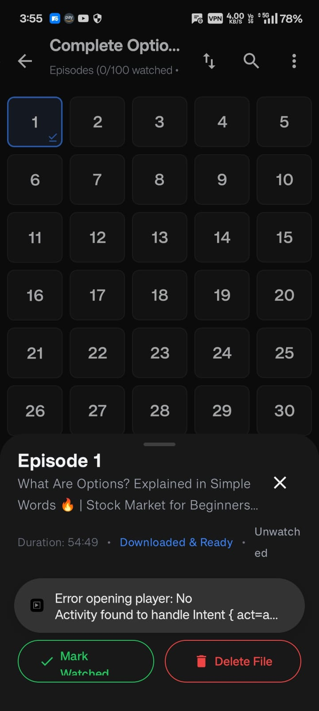
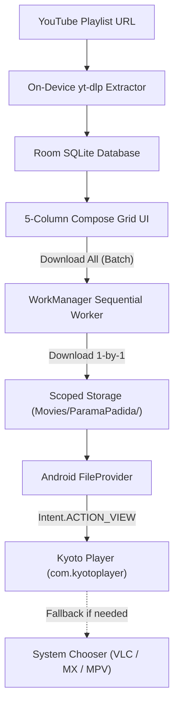

<div align="center">

# 🎓 Parama Padida (பரமா படிடா)

### *Distraction-Free, Offline-First Android Learning App for YouTube Playlists*

[](https://github.com/Yashwant00CR7/parama-padida/releases/tag/v1.0.0)
[-brightgreen.svg?style=for-the-badge)](https://developer.android.com)
[](https://kotlinlang.org)
[](https://developer.android.com/jetpack/compose)
[](https://drive.google.com/file/d/1H4IV590lA7IG0adw-AHBFJ6jOvoq600s/view)

<br/>



<p><em>Episode selection grid with live download status and streamlined Kyoto Player playback</em></p>

</div>

---

## 💡 The Philosophy

Modern video platforms are engineered for infinite scroll, autoplay algorithms, recommendation rabbit holes, and distraction. Learning complex subjects — whether it's software engineering, stock market options, or mathematics — requires **focus, linear progression, and offline discipline**.

**Parama Padida** converts any educational YouTube playlist into a local, self-paced learning course:
* **No feeds, no shorts, no algorithm:** Pure focus on the current episode.
* **100% Download-Only Architecture:** Videos are saved locally to your device storage for offline study anywhere.
* **Pro Video Playback:** Seamlessly delegates playback to **Kyoto Player** via secure Android `FileProvider` URIs.

---

## ✨ Core Features

### 🔢 5-Column Episode Grid UI
A sleek, OLED-friendly dark interface (`#101010` / `#1A1A1A`) featuring a numbered 5-column episode grid:
- 🕒 **Amber Clock Icon**: Episode is queued in the batch download line.
- 🔄 **Live Circular Spinner**: Episode is actively downloading in background.
- ⬇️ **Blue Checkmark Badge**: Episode is fully downloaded and ready for offline playback.
- ✅ **Green Badge / Green Tile**: Episode marked as watched and completed.
- 🔍 **Real-Time Search & Sorting**: Search episodes instantly by number or title, or toggle ascending/descending order.

---

### ⚡ Sequential Batch Downloader (RAM & Battery Optimized)
Downloading 50–100 episodes concurrently crashes mobile devices due to native runtime memory exhaustion. Parama Padida implements a **sequential queue architecture**:
- **Strictly 1-at-a-time**: Processes downloads sequentially in the background via Android `WorkManager` and foreground service.
- **Low Memory Footprint**: Strictly maintains a single `yt-dlp` instance in memory, preventing OS Low-Memory-Killer (OOM) kills.
- **Resilient Queue Processing**: If an individual video encounters a network blip or restriction, it marks it as failed and **automatically continues downloading the rest of the batch**.
- **Unified Foreground Notification**: Clean single-line progress indicator (`Downloading Ep #4 • 26 left in queue • 45%`) with cancellation support.

---

### 🎬 Kyoto Player Integration (`com.kyotoplayer`)
Built specifically to integrate with the **Kyoto Player** media decoder:
- **Zero In-App Bloat**: ExoPlayer and streaming dependencies are stripped for an ultra-light, snappy binary.
- **Multi-Strategy Intent Engine**:
  1. Direct MIME type dispatch (`video/mp4`, `video/x-matroska`, `video/*`)
  2. Content URI scheme resolution
  3. Explicit package launch intents with stream extras
  4. Automatic fallback to Android system player chooser (VLC, MX Player, MPV) so playback is never blocked.

---

### 🐞 Built-In Bug Logs & Diagnostics Console
Troubleshoot issues directly on device without connecting to ADB:
- Accessible anytime from the top app bar via the **Bug Icon** (🐞) or episode bottom sheet.
- **1-Tap "Copy Full Logs"**: Exports a full diagnostic report to your clipboard:
  - Device manufacturer, model, and Android OS / API level.
  - Storage path, write permissions, and available free space.
  - Deep inspection of installed player packages (all declared activities, export flags, intent filters).
  - Intent resolution probe results.
  - Timestamped event logs and exception stack traces.

---

## 🏛 Architecture & Data Flow



---

## 🛠 Tech Stack

| Component | Technology | Purpose |
| :--- | :--- | :--- |
| **Language** | Kotlin 2.0.21 | Modern, safe Android development |
| **UI Framework** | Jetpack Compose + Material 3 | Declarative, reactive UI with OLED dark theme |
| **Database** | AndroidX Room (SQLite) | Local offline persistence for courses, lessons, and notes |
| **Downloader** | `youtubedl-android` (`yt-dlp`) | On-device YouTube playlist parsing & video download |
| **Background Tasks** | AndroidX WorkManager | Reliable background downloads with foreground notification |
| **Image Loading** | Coil Compose | Asynchronous thumbnail caching |
| **External Player** | Kyoto Player via `FileProvider` | Hardware-accelerated local video playback |

---

## 📂 Storage Architecture

On Android 10+ (API 29–35+), Parama Padida stores all downloaded media inside the app's external files directory:
```
/storage/emulated/0/Android/data/com.yashwant.paramapadida/files/Movies/ParamaPadida/<Course Title>/
  ├── 01 - Introduction to Concepts.mp4
  ├── 02 - Deep Dive into Architecture.mp4
  └── ...
```
* **No `MANAGE_EXTERNAL_STORAGE` permission required.**
* Full POSIX filesystem write access without scoped storage friction.
* Files are shared securely with external players using `androidx.core.content.FileProvider`.

---

## 📥 Installation

You can download the compiled release APK directly:

* **Direct Google Drive Link**: [parama-padida-v1.0.0.apk](https://drive.google.com/file/d/1H4IV590lA7IG0adw-AHBFJ6jOvoq600s/view)
* **GitHub Releases**: [Release v1.0.0](https://github.com/Yashwant00CR7/parama-padida/releases/tag/v1.0.0)

> [!NOTE]
> Ensure **Kyoto Player** (`com.kyotoplayer`) is installed on your device for the recommended playback experience. Other players (VLC, MX Player, MPV) are also supported via the automatic system chooser fallback.

---

## 🔨 Building from Source

### Prerequisites
- JDK 17 (Java 17)
- Android SDK (API 35, Build Tools 35.0.0)

### Clone & Build
```bash
# Clone the repository
git clone git@github-personal:Yashwant00CR7/parama-padida.git
cd parama-padida

# Build Release APK
./gradlew assembleRelease

# Install directly on a connected device
./gradlew installDebug
```

The output APK will be generated at:
`app/build/outputs/apk/release/app-release-unsigned.apk`

---

## 👤 Author

Developed by **[Yashwant00CR7](https://github.com/Yashwant00CR7)**.

*Personal learning productivity tool created for uninterrupted, offline study.*
